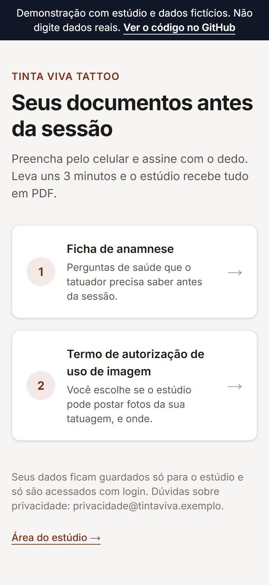
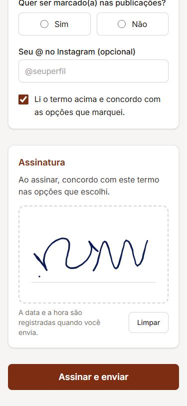
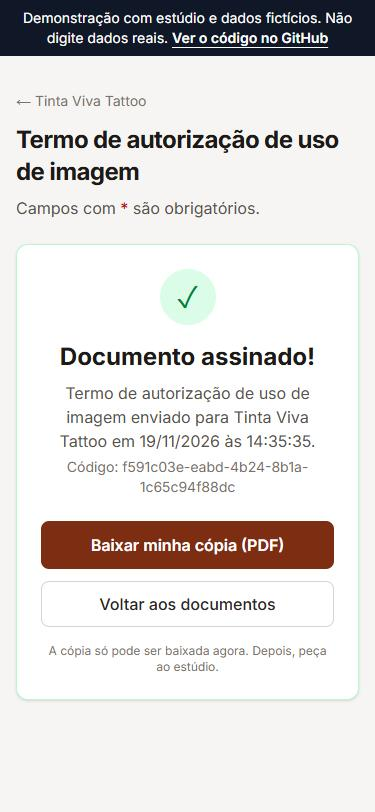
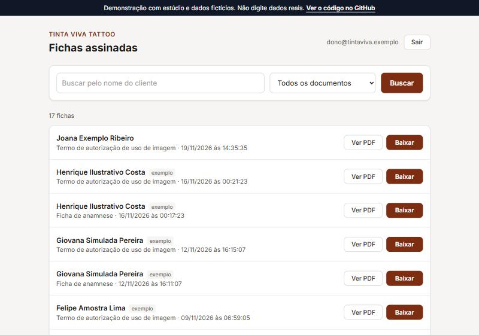
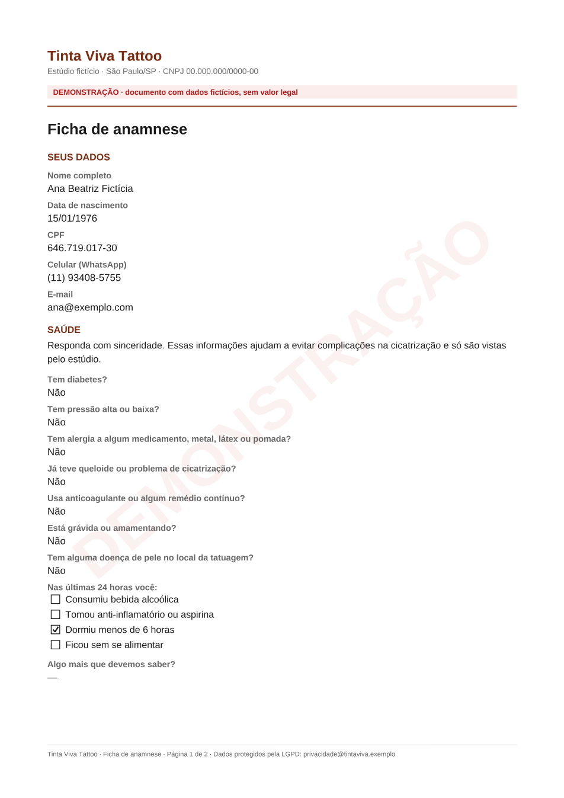
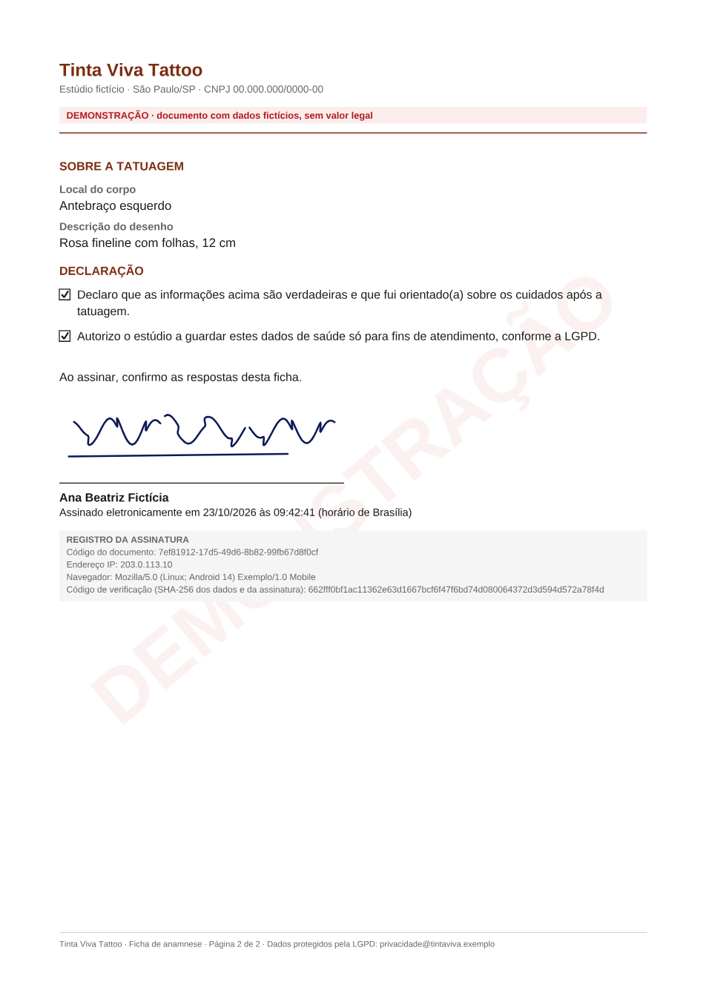

# Ficha digital com assinatura na tela e PDF automático

> ⚠️ **Projeto de demonstração.** O estúdio "Tinta Viva Tattoo", as pessoas, os CPFs e as assinaturas são **fictícios**.
> Todas as páginas mostram uma faixa avisando disso, os PDFs saem com a marca "DEMONSTRAÇÃO" e as páginas não são indexadas pelo Google.
> Não digite dados reais na demo.

Formulário que o cliente abre pelo celular (por um link enviado no WhatsApp, por exemplo), preenche, **assina com o dedo** e envia.
O sistema gera **um PDF na hora** e guarda tudo num **painel com login**, onde o dono do negócio busca pelo nome do cliente e baixa o documento.

O exemplo é um estúdio de tatuagem com dois documentos: **ficha de anamnese** e **termo de autorização de uso de imagem**.
Os textos ficam num único arquivo de configuração, então o mesmo sistema serve para clínica, contrato, matrícula, check-in de hospedagem etc.

| Celular: lista de documentos | Assinatura com o dedo | Confirmação |
|---|---|---|
|  |  |  |

| Painel do estúdio (com login) |
|---|
|  |

| PDF gerado: respostas | PDF gerado: assinatura e registro |
|---|---|
|  |  |

## O problema

Muitos negócios ainda usam ficha de papel: o cliente preenche na recepção, a letra é ruim, o papel se perde, e achar a ficha de alguém de meses atrás é difícil.
Para saúde e estética, a ficha guarda **dados sensíveis** (alergias, remédios, gravidez), que precisam de cuidado pela LGPD.

## A solução

1. O negócio manda o link para o cliente antes do atendimento.
2. O cliente preenche pelo celular. Os campos são validados na hora (CPF, telefone, idade mínima, perguntas obrigatórias).
3. O cliente assina com o dedo. **Data e hora são registradas pelo servidor** no momento do envio.
4. O PDF é gerado automaticamente com as respostas, a assinatura e um bloco de registro (código do documento, IP, navegador e um código de verificação SHA-256 dos dados).
5. O cliente pode baixar a cópia dele logo após assinar.
6. O dono entra no painel, busca pelo nome e abre ou baixa o PDF.

### Por que guardar no painel e não mandar o PDF pelo WhatsApp?

Mandar arquivos pelo WhatsApp de forma automática exige a API oficial da Meta, que é paga por conversa e precisa de aprovação.
Guardar os PDFs num painel com busca resolve o problema principal (achar a ficha depois) sem esse custo. Se fizer sentido, dá para somar um aviso por e-mail a cada ficha nova.

## Dados de saúde e LGPD

Dados de saúde são **dados pessoais sensíveis** pela LGPD (art. 5º, II). Por isso, neste projeto:

- as fichas e os PDFs **só são acessados com login**. Não existe link público para nenhum PDF;
- no Supabase, a tabela tem **RLS ligado e nenhuma policy**, e o bucket dos PDFs é **privado**. Só o servidor acessa, com a chave `service_role`;
- o formulário pede consentimento explícito para guardar os dados de saúde;
- o cookie de sessão é `httpOnly`, assinado e expira em 8 horas;
- as páginas pedem para não ser indexadas por buscadores.

Num projeto real ainda é preciso definir com o cliente: prazo de guarda, política de privacidade, quem tem acesso e como atender pedidos de exclusão.

**Sobre a assinatura:** é uma *assinatura eletrônica simples* (Lei 14.063/2020), com registro de data, hora, IP e navegador. Para documentos que exigem assinatura qualificada (certificado ICP-Brasil), o caminho é outro.

## Stack

- **Next.js 16 (App Router) + TypeScript + Tailwind CSS 4**, pronto para a Vercel
- **signature_pad** para a assinatura com dedo ou mouse
- **pdf-lib** para gerar o PDF
- **Supabase** (PostgreSQL + Storage) para guardar fichas e PDFs, **opcional**: sem ele, a demo grava em disco
- **zod** para validar o formato do que chega na API
- **Vitest** para testes, **ESLint** e **GitHub Actions** (lint, tipos, testes e build a cada push)

### Decisões técnicas

- **PDF com pdf-lib, sem navegador headless.** É JavaScript puro: roda na Vercel sem Chrome, gera o PDF em milissegundos e funciona nos testes.
- **Assinatura guardada como vetor**, não como imagem. Os traços vão para o banco e são desenhados no PDF como linhas, então a assinatura fica nítida em qualquer zoom e ocupa pouco espaço.
- **A mesma validação no navegador e no servidor.** As mensagens aparecem na hora para o cliente, e o servidor nunca confia no que chega: revalida tudo e descarta campos que não existem no documento.
- **Login próprio em vez de Supabase Auth.** O painel tem um único usuário (o dono). Um cookie assinado com HMAC resolve isso sem depender de outro serviço. Para vários usuários, trocar por Supabase Auth é direto.
- **Armazenamento trocável.** Existe uma interface `Repositorio` com duas implementações: disco local (para rodar a demo sem conta nenhuma) e Supabase (para produção).

## Como rodar localmente

Precisa de Node.js 22 ou mais novo.

```bash
npm install
npm run dev
```

Abra <http://localhost:3000>. Sem nenhuma configuração, a demo:

- grava fichas e PDFs na pasta `.dados/` (fora do Git);
- cria 16 fichas fictícias de exemplo na primeira vez;
- mostra o **login de demonstração** na tela do painel: `dono@tintaviva.exemplo` / `demo1234`.

Para apagar tudo e recomeçar, apague a pasta `.dados`. Para criar as fichas de exemplo de novo: `npm run seed`.

### Comandos

| Comando | O que faz |
|---|---|
| `npm run dev` | Servidor de desenvolvimento |
| `npm test` | Testes (validação, PDF, sessão e fluxo completo) |
| `npm run lint` | ESLint |
| `npm run typecheck` | Checagem de tipos do TypeScript |
| `npm run build` | Build de produção |
| `npm run seed` | Cria as fichas fictícias de exemplo |

## Como adaptar para outro cliente

Edite **só** o arquivo [`src/config/documentos.ts`](src/config/documentos.ts):

- `negocio`: nome, subtítulo do PDF, cor principal, fuso horário e contato de privacidade;
- `demonstracao`: apague este bloco num cliente real (some a faixa e a marca "DEMONSTRAÇÃO" do PDF);
- `documentos`: cada documento tem seções com parágrafos (cláusulas) e campos.

Tipos de campo disponíveis:

| Tipo | Uso |
|---|---|
| `texto` | Linha de texto. Formatos: `cpf`, `telefone`, `email`, `data` (com `idadeMinima` opcional) |
| `textoLongo` | Caixa de várias linhas |
| `simNao` | Sim ou não, com `detalharSeSim` para pedir detalhes quando a resposta é "sim" |
| `marcar` | Várias caixas de marcar |
| `escolha` | Uma opção entre várias |
| `aceite` | Caixa que precisa ser marcada ("declaro que…", consentimento LGPD) |

Exemplo de um campo novo:

```ts
{ tipo: "simNao", id: "fumante", rotulo: "Você fuma?", obrigatorio: true }
```

O formulário, a validação e o PDF se ajustam sozinhos. Cada documento ganha um link próprio: `/assinar/<id-do-documento>`.

## Publicar com Supabase e Vercel

1. Crie um projeto no Supabase e rode [`supabase/schema.sql`](supabase/schema.sql) no SQL Editor (cria a tabela e o bucket privado).
2. Na Vercel, importe o repositório e defina as variáveis de ambiente (veja [`.env.example`](.env.example)):
   - `SUPABASE_URL` e `SUPABASE_SERVICE_ROLE_KEY`;
   - `SESSAO_SEGREDO`, com 32 caracteres aleatórios ou mais (obrigatório em produção);
   - `PAINEL_EMAIL` e `PAINEL_SENHA`;
   - `MODO_DEMO=false` num cliente real (desliga o login de demonstração e as fichas de exemplo).
3. Opcional: `npm run seed` com as variáveis do Supabase cria as fichas de exemplo lá.

> Na Vercel o disco não é permanente, então em produção o Supabase é obrigatório.

## Limites conhecidos

- Não há limite de envios por IP. Para uma página aberta em produção, vale somar um limitador (Vercel Firewall ou Upstash) ou um captcha.
- Na demo pública, qualquer pessoa com o login de demonstração vê o que outros visitantes enviaram. Por isso o aviso para não usar dados reais.
- O aviso por e-mail a cada ficha nova não está implementado nesta demo.

## Estrutura

```
src/config/documentos.ts     textos dos documentos (o que muda por cliente)
src/lib/validacao.ts         regras de validação (navegador e servidor)
src/lib/pdf.ts               geração do PDF
src/lib/fichas.ts            fluxo de envio: valida, carimba data/hora, gera hash e PDF, guarda
src/lib/armazenamento/       disco local e Supabase
src/lib/sessao.ts            cookie de sessão assinado
src/app/assinar/[documento]  página pública do formulário
src/app/painel               login e lista de fichas
src/app/api/fichas           envio e download do PDF
tests/                       testes com Vitest
```

---

Feito por [Fernando Tenório](https://github.com/dotenorio) como projeto de portfólio.
